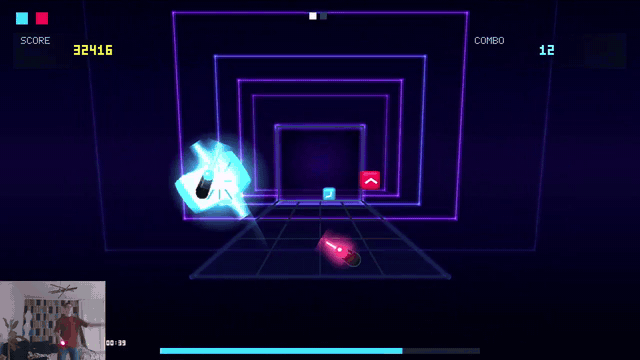

# MoveBeat

[English](README.md) · **Русский**

Экспериментальная свободная ритм-игра для PlayStation 3 с двумя контроллерами
PlayStation Move и камерой PlayStation Eye. Вы рубите летящие блоки двумя
клинками под музыку; карты берутся с BeatSaver. Проект воспроизводит общий
жанр, но **не содержит код, музыку, карты, модели, название или другие
материалы Beat Saber**.

[](https://youtu.be/wMVJnFPkHqQ)

▶ [Смотреть 30-секундный ролик](https://youtu.be/wMVJnFPkHqQ)

Ранняя версия: проверена на одной консоли (HEN, PS Eye под телевизором, около
2 м до игрока) и в эмуляторе RPCS3. Трекинг сильно зависит от освещения и
положения камеры. Сообщения об ошибках и `run_status.ini` из
`/dev_hdd0/game/MOVEBEAT1/USRDIR/` приветствуются в Issues.

## Быстрый старт

**Нужно:** PS3 с HEN или CFW (установка неподписанных PKG), два PS Move,
камера PS Eye, флешка FAT32 и Windows-ПК для скачивания песен.

1. Скачайте из [Releases](../../releases) `movebeat.pkg` и
   `MoveBeatTrackAssistant.zip`.
2. Установите `movebeat.pkg` на PS3 (Package Manager → Install Package Files,
   с флешки или по FTP). В пакете только встроенная обучающая мелодия.
3. Запустите ассистент на ПК, нажмите **«Стартовый набор»**: он скачает с
   BeatSaver шесть карт и плей-лист «MoveBeat Starter». Любую другую карту
   можно найти по названию или по `!bsr`-коду.
4. Вставьте флешку и нажмите **«Все уровни на флешку»** (ассистент проверит,
   что флешка в FAT32).
5. Вставьте флешку в PS3 и запустите MoveBeat: игра скопирует уровни в свою
   библиотеку на жёстком диске («USB COPY…» справа вверху), после этого
   флешку можно вынуть.
6. Встаньте примерно в двух метрах от камеры. Выберите трек, нажмите Move,
   пройдите калибровку и играйте.

Музыка карт принадлежит её правообладателям: скачивайте и используйте их по
правилам BeatSaver и с разрешения авторов, не выкладывайте готовые наборы с
музыкой.

## Управление

| Экран | Кнопка | Действие |
|---|---|---|
| Список треков | Triangle / Circle | трек выше / ниже (удержание — прокрутка) |
| | Cross | следующая сложность |
| | Square | полки: все треки, затем плей-листы |
| | Move (одно нажатие) или Start | старт через калибровку |
| | Move на обоих, удерживать | рандомайзер |
| | T + движение | вверх-вниз — прокрутка с инерцией, вбок — сложность |
| | T + Circle / Square | смещение тайминга +10 / −10 мс |
| | оба T + Circle / Square | длина клинка +5 / −5 см |
| | оба T + Select | поменять руки местами |
| Калибровка | Move на каждом контроллере | «я в позе» |
| | Triangle | начать заново с первой позы |
| | Cross | выйти (к треку или в меню паузы) |
| Песня | Start | пауза |
| Пауза | Cross / Circle / Square / Triangle | продолжить / заново / калибровка / к трекам |
| Потеря трекинга | Move на потерянном Move (в камеру) / Triangle | перекалибровать сферу / к трекам |
| Результаты | Cross, Circle или Move / Triangle | продолжить / переиграть |
| Между песнями плей-листа | Cross, Circle или Move / Triangle / Square | следующая сразу / переиграть последнюю / стоп |
| Итоги плей-листа | Cross, Circle или Move | к трекам |

**Калибровка** — три позы: оба Move на вытянутых руках вперёд (клинками в
камеру), в стороны, вниз. Каждую позу подтверждайте кнопкой Move на обоих
контроллерах. По позам игра определяет, где левая и правая рука (красная
сфера — правая, синяя — левая), ширину рук и глубину игровой зоны. Из меню
паузы калибровку можно повторить.

**Во время песни** счёт слева вверху, комбо справа вверху; при сбросе комбо
экран вспыхивает красным. Внизу — оставшееся время и прогресс песни. Удар по
блоку ощущается вибрацией в этой руке; касание стены клинком — долгой
вибрацией обоих контроллеров, пока клинок в стене, и сбрасывает комбо. Пока
проигрыш по энергии выключен, песня всегда играется до конца, и полоса жизни
не показывается. В результатах — счёт, лучший счёт на этой сложности,
попадания, максимальное комбо и промахи.

**Если камера потеряла Move**, игра встаёт на паузу и продолжает сама, как
только видит оба контроллера. Если сфера потерялась надолго, направьте Move в
камеру и нажмите на нём Move.

Смещение тайминга (−500…+500 мс; положительное выводит ноты раньше) и длина
клинка (50–140 см) сохраняются в `USRDIR/settings.ini`.

## Импорт песен

### Windows-ассистент

`MoveBeatTrackAssistant.exe` из Releases. Язык (русский или английский)
выбирается по языку Windows, переключатель — справа вверху окна.

- **«Стартовый набор»** — шесть карт и плей-лист «MoveBeat Starter».
- **Поиск** по названию, автору, ID (`54851`) или BSR-команде
  (`!bsr 54851`), с обложкой, сложностями и размером архива; «Подготовить
  уровень» скачивает карту и проверяет её SHA-1. Можно открыть и уже
  скачанный ZIP.
- **Флешка:** «Уровень на флешку» и «Все уровни на флешку». Ассистент
  отказывается от носителей не в FAT32 (PS3 читает с USB только FAT32),
  копирует уровни в `MOVEBEAT/levels/` и проверяет каждый файл по SHA-256.
- **FTP:** отправка уровня на PS3 с webMAN MOD или другим FTP-сервером.
  Обычный FTP не шифрует передачу, используйте только доверенную сеть;
  пароль не сохраняется. По Wi-Fi большие файлы могут не дойти, флешка
  надёжнее.

### Флешка → PS3

Вставьте флешку в PS3 до запуска игры или прямо в списке треков. Игра
просматривает `/dev_usb000`–`/dev_usb007` и копирует новые папки из
`MOVEBEAT/levels/` в библиотеку на жёстком диске («USB COPY 3 OF 12», затем
«USB ADDED 12»). Копирование идёт только в меню: во время калибровки и игры
шина USB занята камерой. Папка с именем, которое уже есть на жёстком диске,
пропускается.

### Командная строка

```sh
python tools/starter_set.py --output out/levels
python tools/beatsaver_import.py --search "название или автор" --limit 10
python tools/beatsaver_import.py --key 3b31 --output out/levels
python tools/beatsaver_import.py --zip path/to/map.zip --output out/levels
python tools/playlist_import.py https://beatsaver.com/playlists/1176968
python tools/usb_export.py E: --all out/levels
```

Импортёр берёт новейшую версию карты, проверяет архив по SHA-1 из BeatSaver API
и пишет папку уровня: `level.ini`, `.mbchart` для каждой сложности, исходные
аудио и обложку и карточку `library.mblc` для меню PS3. Поддерживаются beatmap
v2, v3 и v4, `Standard` и `NoArrows`, бомбы, стены, chains и arcs, все
сложности и смены BPM. Аудио должно быть Ogg Vorbis (по содержимому, `.egg`
подходит).

`playlist_import.py` принимает `.bplist`-файл, ссылку на плей-лист BeatSaver
или его номер, докачивает недостающие карты и пишет папку `playlist-<id>`. На
PS3 Square переключает полки: «все треки», затем плей-листы. Старт на полке
плей-листа проигрывает его с выбранной песни до конца, с результатами и
8-секундным отсчётом между песнями и итогами в конце.

Уровни можно и вложить в собственный PKG (только для себя):
`bash tools/build_ps3.sh --include-imported` берёт всё из `out/levels`. Без
этого флага пакет содержит только обучающий уровень First Steps.

## Сборка

Нужны CMake 3.16+ и компилятор C++11. Ядро игры и тесты на ПК:

```sh
cmake -S . -B build
cmake --build build
ctest --test-dir build --output-on-failure
```

В Windows удобнее генератор `-G "Visual Studio 17 2022" -A x64` и
`--config Debug`. `movebeat_demo` — консольный симулятор, который проигрывает
карту идеальными взмахами и проверяет, что ядро ведёт себя одинаково на ПК и
PS3:

```sh
./build/movebeat_demo out/levels/<BeatSaver-ID>
```

PS3-пакет собирается PS3DEV/PSL1GHT (в Linux или WSL2):

```sh
bash tools/build_ps3.sh
```

Результат — `out/ps3/movebeat.pkg` и отдельный пакет с PPU-тестами. CI
(`.github/workflows/build.yml`) собирает ядро, тесты и PKG на каждый push.
Автоматические прогоны в RPCS3: `tools/rpcs3_pkg_install_smoke.ps1`,
`tools/rpcs3_menu_smoke.ps1` (меню, плей-лист, пауза, импорт с флешки),
`tools/rpcs3_ppu_tests.ps1`.

Windows-ассистент: `tools/build_assistant.ps1` (PyInstaller в отдельном
`.venv-assistant`, SHA-256 рядом с EXE; встроенные компоненты —
`assistant/THIRD_PARTY_NOTICES.md`). Android-клиент (Kotlin, ранний прототип:
поиск и конвертация карт, FTP) — в [`android`](android/README_RU.md).

## Формат карт

`.mbchart` — UTF-8 текст:

```text
# time_ms,lane,row,hand,direction
1000,1,1,L,D
1500,2,1,R,U
# W,time_ms,duration_ms,lane,width,row,height
W,2000,1000,0,1,0,3
# C,time_ms,lane,row,hand
C,2200,2,1,R
# A,head_ms,tail_ms,head_lane,head_row,tail_lane,tail_row,hand
A,2500,3200,0,0,3,2,L
```

- `lane`: `0..3` слева направо; `row`: `0..2` снизу вверх;
- `hand`: `L`, `R` или `B` (бомба);
- `direction`: `U`, `D`, `L`, `R`, `UL`, `UR`, `DL`, `DR` или `A` (любое);
- `W` — стена: начало, длительность и прямоугольник на сетке 4×3;
- `C` — звено chain; `A` — визуальная дуга.

Формат папки уровня — [`docs/MOVEBEAT_BUNDLE_FORMAT.md`](docs/MOVEBEAT_BUNDLE_FORMAT.md).
Обучающий уровень First Steps (18 с, 120 BPM) синтезирован
`tools/generate_tutorial.py` без сторонних записей.

## Документация

- [`docs/TROUBLESHOOTING_RU.md`](docs/TROUBLESHOOTING_RU.md) — расстановка
  камеры, сообщения игры, коды ошибок запуска и что прислать в Issue;
- [`ps3/README.md`](ps3/README.md) (англ.) — как устроена и собирается игра,
  файлы в USRDIR;
- [`docs/MOVEBEAT_BUNDLE_FORMAT.md`](docs/MOVEBEAT_BUNDLE_FORMAT.md) (англ.) —
  формат папки уровня;
- [`CHANGELOG.md`](CHANGELOG.md) (англ.) — изменения по версиям.

Для записи сырых данных `gemState` удерживайте оба T и нажмите Start в списке
треков: 30 секунд пишутся в `USRDIR/gem_capture.csv`.

## Правовой статус

Код распространяется по лицензии MIT ([`LICENSE`](LICENSE)). MoveBeat не связан
с Beat Games, Meta, Sony или правообладателями музыки. BeatSaver требует, чтобы
загрузивший карту имел права на её распространение, и запрещает повторную
публикацию без разрешения автора: импорт предназначен для личного
использования, и за права на конкретную музыку и карту отвечает пользователь.
