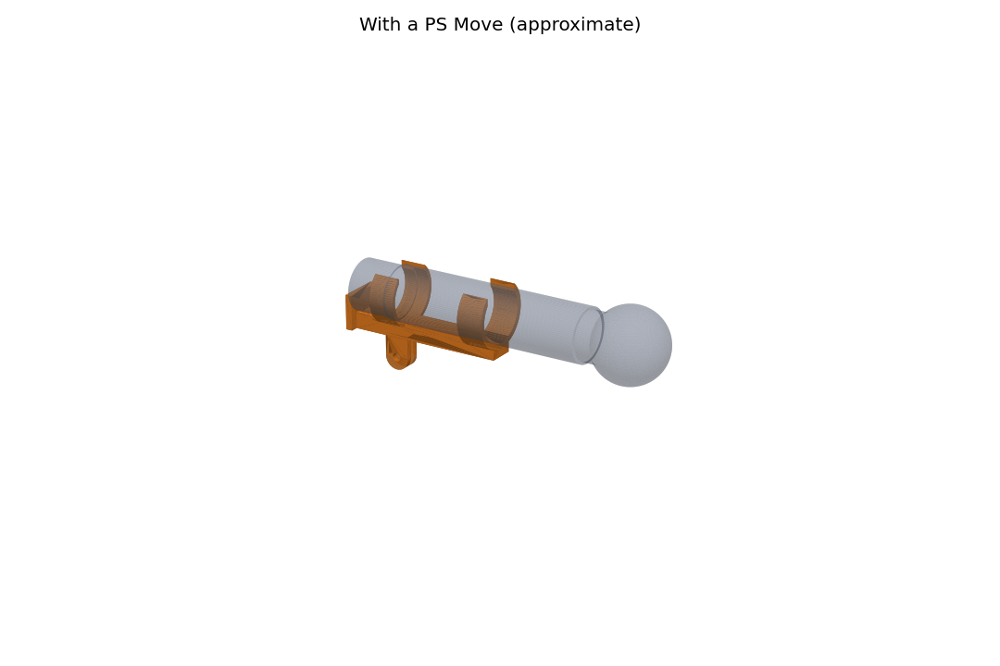

# PS Move head mount

A holder for wearing a PS Move on the head for the head-camera mode: the
controller lies level with its buttons up and the sphere facing the screen.
Two snap clips hold the handle, a rear stop keeps it from sliding back, and a
GoPro-style two-finger mount (M5 thumb screw) fits the three-finger buckle of
any action-camera head strap; the strap's hinge levels the controller.



## Fit first

The Move's handle is not round and Sony publishes no handle size, so the
clip sizes are estimates. Print `fit_gauge.stl` first (about 15 minutes):
six open rings, 30-40 mm, marked by notches on their tabs (one notch =
30 mm, six = 40 mm). Find the ring that snaps on firmly about 25 mm and
85 mm from the controller's bottom end, keeping the second clip clear of
the trigger and the side Start/Select buttons. Then set `REAR_WIDTH`,
`REAR_HEIGHT`, `FRONT_WIDTH`, `FRONT_HEIGHT` (and the clip positions) at the
top of `head_mount.py` and run it again:

```sh
pip install manifold3d trimesh numpy matplotlib
python head_mount.py --preview
```

## Printing

- PETG (or PLA), 0.2 mm layers, 4 perimeters, 30 % infill.
- Stand `move_head_mount.stl` on its rear stop (the flat end) with a brim.
  Each layer of a clip is then a whole C, so it flexes without splitting.
- An M5 x 20 GoPro thumb screw fastens it to the strap buckle.
